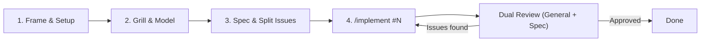

# AI Workflow & Transcripts

This directory contains exported AI session transcripts from building `transaction-engine`, along with a brief overview of the workflow used.

## Workflow

1. **Frame & setup (`/setup-project-skills`):** Configure repo conventions (`AGENTS.md`, domain docs, issue tracking), point the agent at the specification, and state my initial understanding and design direction up front.
2. **Align & model (`/grill-with-docs`):** Run a structured interview grounded in the specification to surface ambiguities and align on every assumption, then capture the shared language and key decisions in [`GLOSSARY.md`](../../GLOSSARY.md) and [`docs/adr/`](../adr/).
3. **Spec & split (`to-spec`):** Turn the agreed design into a tracked parent specification and slice it into small, independent implementation issues with clear seams.
4. **Scoped implementation & dual review (`/implement #N`):** Execute one issue per session to keep context small and focused. After implementation and tests pass, spawn two parallel review agents—one for **general code/standards review** and one for **spec compliance**. Any findings are fixed before the issue is closed.

## Transcripts

| File | Tool | Scope |
| --- | --- | --- |
| [`20261124_setup_project_skills.md`](./20261124_setup_project_skills.md) | Claude Code | Repo skill setup, `/grill-with-docs` alignment, glossary/ADR modeling, and spec breakdown |
| [`20261124_implement_3.md`](./20261124_implement_3.md) | Claude Code | `/implement #3` — hand-derived acceptance fixture CSV pairs (data only) |
| [`20261125_implement_issue_5_antigravity.md`](./20261125_implement_issue_5_antigravity.md) | Antigravity | `/implement #5` — `Engine` transactions (deposits, withdrawals, duplicate IDs, locking, overflow) |
| [`20261124_implement_6.md`](./20261124_implement_6.md) | Claude Code | `/implement #6` — `Engine` dispute lifecycle (dispute, resolve, chargeback) |
